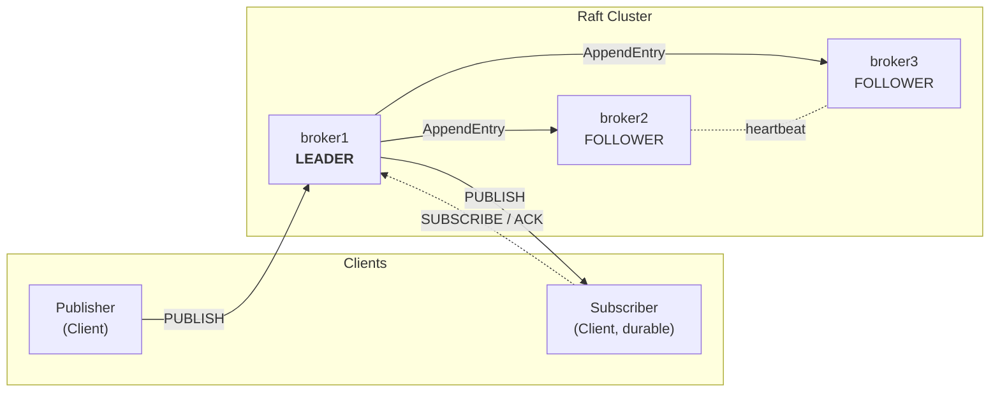
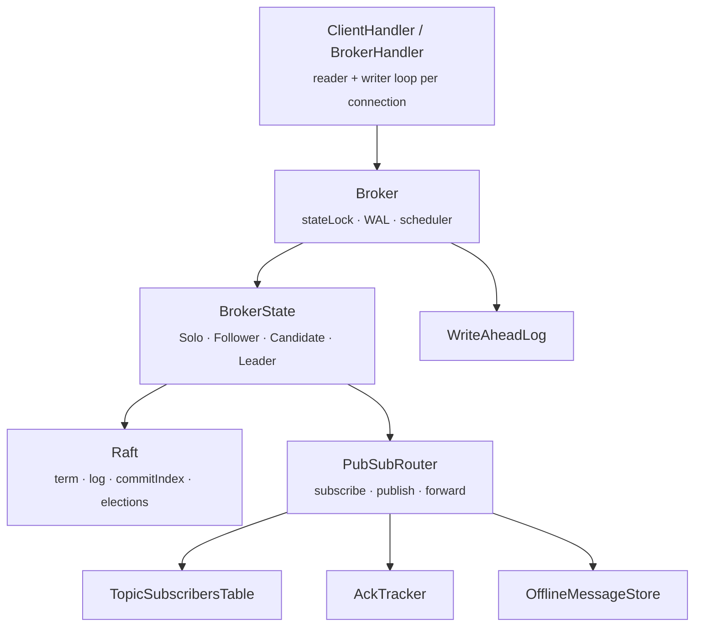
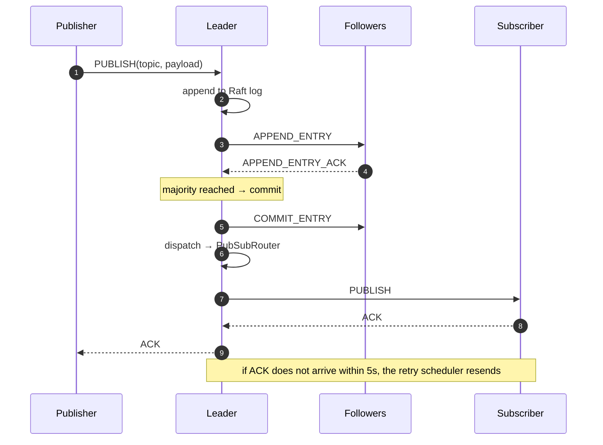
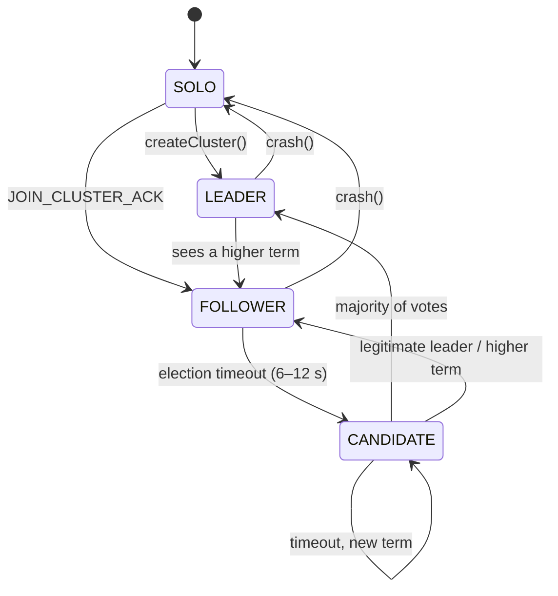
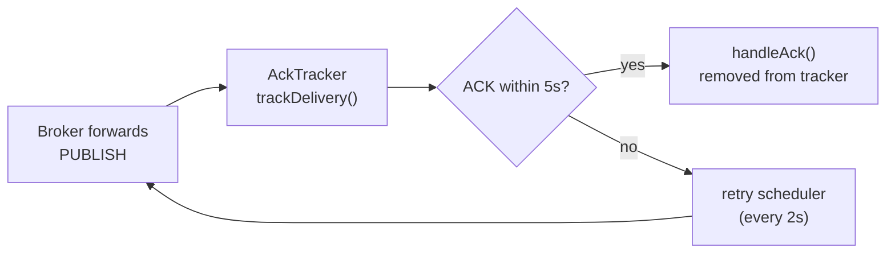
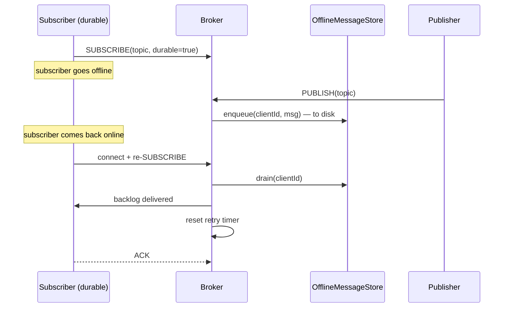

<div align="center">



<br/>

# fault-tolerant-pubsub

**A distributed publish/subscribe system, replicated with Raft and resilient to network crashes.**

<br/>


[Overview](#overview) ·
[Architecture](#architecture) ·
[Raft](#raft-leader-election-and-replication) ·
[Durability](#durability-and-delivery-guarantees) ·
[Quick start](#quick-start) ·
[Chaos testing](#chaos-testing-with-tc-netem) ·
[Known limits](#known-limits-and-roadmap)
[Contributing](#contributing)
[Authors](#authors)
[License](#license)

</div>

---

## Overview

`fault-tolerant-pubsub` is a publish/subscribe message broker written in Java, designed to **keep working when nodes die, the network partitions, or clients disappear**.

Multiple brokers form a **Raft cluster**: a leader receives client operations (`SUBSCRIBE`, `UNSUBSCRIBE`, `PUBLISH`), replicates them in its log, waits for a majority, and only then applies them. If the leader crashes, the followers elect a new one. Clients are **automatically redirected** to the current leader and **reconnect on their own**.

| | |
|---|---|
| 🗳️ **Raft Consensus** | Leader election, log replication, majority commit, `InstallSnapshot` for lagging followers. |
| 📬 **At-least-once delivery** | Every forwarded message is tracked by an `AckTracker` and resent until an ACK is received. |
| 💾 **Write-Ahead Log + Snapshot** | State can be reconstructed after a crash; atomic snapshot is taken when the WAL exceeds 5 MB. |
| 🔔 **Durable subscriptions** | The subscriber can go offline: messages are buffered to disk and delivered upon reconnection. |
| ♻️ **Deduplication** | Caffeine cache (10,000 entries, 2 min TTL) to ignore duplicates caused by retries. |
| 🧭 **Leader redirect** | A follower responds with `REDIRECT_TO_LEADER`; the client automatically moves. |
| 🧪 **Fault injection** | Built-in `crash()` / `resurrect()` + network testing with `tc netem` on Docker. |

---

## Architecture



### Inside a broker

Each `Broker` is composed of a few components with clear responsibilities:



| Component | Responsibility |
|---|---|
| **`ConnectionHandler`** | One TCP connection = one reader loop + one writer loop with an outbound queue. `ClientHandler` and `BrokerHandler` specialize in registration. |
| **`ConnectionRegistry`** | Tracks who is connected. For clients, disconnection does **not** delete the record (needed for durable subscriptions); for brokers, it does. |
| **`BrokerState`** | *(State pattern)* `SoloState`, `FollowerState`, `CandidateState`, and `LeaderState` decide what to do with each incoming message. |
| **`Raft`** | Term, `votedFor`, in-memory log, `commitIndex`/`lastApplied`, `nextIndex`/`matchIndex` for followers, snapshot logic. |
| **`PubSubRouter`** | Pub/Sub logic: deduplication, table updates, forwarding to clients and interested brokers. |
| **`TopicSubscribersTable`** | `topic → {local clients, interested brokers + next hop}` and index of durable subscriptions. |
| **`AckTracker`** | Messages sent but not yet acknowledged, with a timestamp for retries. |
| **`OfflineMessageStore`** | One JSON file per client, written atomically (`.tmp` + `ATOMIC_MOVE`). |
| **`WriteAheadLog`** | Append-only log + atomic snapshot + `RaftMetadata` (`currentTerm`, `votedFor`, …). |

### `PUBLISH` Flow



---

## Raft: leader election and replication

Each broker is a state machine. A node starts as `SOLO` and can either **create** a cluster (becomes `LEADER` at term 1) or **join** an existing one (becomes `FOLLOWER`).



### Failover, step by step

<div align="center">

</div>

1. **Steady state.** The leader sends heartbeats and `APPEND_ENTRY` every 3s; followers reset their election timers.
2. **Isolation.** The leader loses its network connection. Followers stop hearing from it; the isolated leader *still believes it is the leader* (old term).
3. **Election.** The randomized timer (6–12s) of the first follower expires: it increments the term, votes for itself, and sends `REQUEST_VOTE`. With 2 out of 3 votes, it becomes the new leader.
4. **Recovery.** Once the network is restored, the old leader receives an `APPEND_ENTRY` with a higher term, **steps down**, aligns with the new leader's log, and if too far behind, receives an `INSTALL_SNAPSHOT`.

> [!NOTE]
> Step 4 requires that **`LeaderState` also handles `APPEND_ENTRY`** (delegating to `Raft.handleAppendEntry`, which already contains the step-down logic). Without that `case`, the message ends up in `dispatchMessage` and gets discarded: the old leader remains a "zombie" and triggers chain elections. See [Known limits](#known-limits-and-roadmap).

### Protocol messages

| Category | Messages |
|---|---|
| **Client ↔ Broker** | `PUBLISH`, `SUBSCRIBE` (`durable` flag), `UNSUBSCRIBE`, `ACK`, `HEARTBEAT`, `REDIRECT_TO_LEADER` |
| **Broker-to-Broker Routing** | `BROKER_PUBLISH`, `BROKER_SUBSCRIBE`, `BROKER_UNSUBSCRIBE`, `BROKER_HELLO` |
| **Raft** | `REQUEST_VOTE`, `REQUEST_VOTE_ACK`, `APPEND_ENTRY`, `APPEND_ENTRY_ACK`, `COMMIT_ENTRY`, `INSTALL_SNAPSHOT`, `INSTALL_SNAPSHOT_ACK` |
| **Membership** | `JOIN_CLUSTER`, `JOIN_CLUSTER_ACK` |
| **Internal (WAL/snapshot)** | `SNAPSHOT_PENDING_DELIVERY` |

Messages are serialized into JSON using Jackson; the message type is carried in the `type` property (`@JsonTypeInfo` / `@JsonSubTypes` on `Message`). A message ID is formatted as `senderId:sequenceNumber:timestamp`, ensuring a client restarting from 0 does not generate collisions.

---

## Durability and delivery guarantees

### At-least-once



The same pattern applies on the client side: `publish`, `subscribe`, and `unsubscribe` are placed into `pendingMessages` and resent until the broker responds with an `ACK`.
**At-least-once means possible duplicates**: the deduplication cache filters them between brokers, but client applications should still be idempotent.

### Write-Ahead Log and Snapshot

- Every "state-changing" message is appended to the WAL (with a `flush`) **before** being processed; heartbeats and Raft traffic are excluded.
- On restart, `recoverState()` reads the WAL and rebuilds subscriptions, durable flags, and pending messages awaiting an ACK.
- When it exceeds **5 MB**, the broker writes an **atomic snapshot** (`.tmp` + `ATOMIC_MOVE`) containing the subscriptions and `PendingDeliveryMessage`s, saves the `RaftMetadata`, and clears log payloads from RAM.
- A corrupted log line (e.g., crash mid-write) is skipped and does not block recovery.
- `RaftMetadata` persists `currentTerm` and `votedFor`: without this, a restarted node might vote twice in the same term.

### Durable subscriptions



A **non-durable** subscription is removed upon disconnection, and any missed messages are not buffered.

---

## Project structure

```text
src/main/java/it/polimi/pubsub/
├── Main.java                       # Broker CLI entry point
├── broker/
│   ├── Broker.java                 # Orchestrator: WAL, scheduler, TCP listener, snapshot
│   ├── BrokerState.java            # State pattern interface
│   ├── components/
│   │   ├── ConnectionHandler.java  # Reader/writer loop (abstract)
│   │   ├── ClientHandler.java
│   │   ├── BrokerHandler.java      # Includes BROKER_HELLO handshake
│   │   ├── ConnectionRegistry.java
│   │   ├── PubSubRouter.java
│   │   ├── TopicSubscribersTable.java
│   │   ├── AckTracker.java · PendingMessage.java
│   │   ├── OfflineMessageStore.java
│   │   ├── BrokerAddress.java · BrokerRole.java · ClientStatus.java
│   ├── raft/Raft.java              # Consensus: elections, replication, snapshot
│   ├── states/                     # Solo · Follower · Candidate · Leader
│   └── storage/                    # WriteAheadLog · LogEntry · RaftMetadata
├── client/
│   ├── Client.java                 # Publisher + Subscriber, auto-reconnect
│   ├── Publisher.java · Subscriber.java
│   └── ClientPendingMessage.java
├── messages/                       # Message and client messages
│   └── brokerMessages/             # Broker-to-Broker and Raft messages
└── network/                        # TcpConnection · MessageSerializer
```

---

## Quick start

### Requirements

- JDK **21**
- Maven 3.9+
- Docker + Docker Compose (for the test cluster)

### Build

```bash
mvn clean package
```

The `maven-shade-plugin` produces an executable jar with `it.polimi.pubsub.Main` as the main class.

### Start a broker

```text
java -cp app.jar it.polimi.pubsub.Main \
     <brokerId> <brokerPort> <clientPort> <walPath> <offlineDir> \
     [create | join <peerHost> <peerBrokerPort>]
```

| Argument | Meaning |
|---|---|
| `brokerId` | Unique identifier of the broker (e.g. `broker1`) |
| `brokerPort` | Port for **broker-to-broker** traffic (Raft, routing) |
| `clientPort` | Port for **clients** |
| `walPath` | Write-Ahead Log file path |
| `offlineDir` | Directory for the offline message buffer |
| `create` | Creates a new cluster; the broker becomes leader at term 1 |
| `join host port` | Joins an existing cluster by contacting a peer |

### Three-node cluster with Docker

```bash
docker compose up --build
```

| Broker | Initial Role | Client port (host) | Broker port (internal) |
|---|---|---|---|
| `broker1` | creates cluster → **LEADER** | `8080` | `8090` |
| `broker2` | `join broker1 8090` → FOLLOWER | `8081` | `8091` |
| `broker3` | `join broker1 8090` → FOLLOWER | `8082` | `8092` |

### Using the client

```java
Client sub = new Client("sub-1", "localhost", 8080);
sub.enableAutoReconnect(true);
sub.connect();

// durable: survives disconnections, messages are buffered
sub.subscribeDurable("SystemStatus");

Client pub = new Client("pub-1", "localhost", 8081); // even a follower is fine: you will be redirected
pub.connect();
pub.publish("SystemStatus", "hello".getBytes());
```

You do not need to know who the leader is: if contacting a follower, the client receives a `REDIRECT_TO_LEADER`, closes the socket, and reconnects to the leader. If the target does not respond, it falls back to the bootstrap broker.

---

## Chaos testing with `tc netem`

The containers are provided with `NET_ADMIN`, so you can degrade the network of a single broker.

```bash
# isolate broker1 (100% packet loss)
docker exec broker1 tc qdisc replace dev eth0 root netem loss 100%

# restore the network
docker exec broker1 tc qdisc del dev eth0 root
```

The complete scenario can be found in [`EmulationClientTest`](src/main/java/it/polimi/pubsub/EmulationClientTest.java):

| Time | What happens |
|---|---|
| t = 0 | `sub-docker` connects to `broker1` and calls `subscribeDurable("SystemStatus")` |
| t ≈ 1s | **You** isolate `broker1` with `tc` |
| t ≈ 21s | `pub-docker` connects to `broker2` and publishes: the message is replicated with the new leader |
| t ≈ 22s | **You** restore the network |
| t ≈ 37s | `sub-docker` reconnects and receives the buffered messages |

To simulate a "clean" in-process crash, you can also use `Broker.crash()` and `Broker.resurrect(host, port)`.

---

## Main parameters

| Parameter | Value | Where |
|---|---|---|
| Heartbeat interval | 3s | `Broker`, `Client` |
| Connection heartbeat timeout | 25s | `Broker` |
| Election timeout | random 6–12s | `Raft` |
| ACK timeout | 5s | `Broker`, `Client` |
| Retry interval | 2s | `Broker`, `Client` |
| Deduplication cache | 10,000 entries / 2 min | `Broker`, `PubSubRouter` |
| Snapshot threshold | 5 MB (checked every 50 msgs) | `Broker` |
| Client reconnect attempts | 10 | `Client` |

> [!TIP]
> Heartbeat (3s) ≪ election timeout (6–12s) is the correct ratio for Raft. If you increase network latency (e.g., nodes in different geographic locations), raise both values accordingly.

---

## Known limits and roadmap

This project started as a university assignment; these are the open issues, ordered by priority.

**Raft Correctness**
- [ ] `LeaderState` needs to handle `APPEND_ENTRY` (step-down of the old leader after a partition).
- [ ] Heartbeats should distinguish between *connection liveness* and *leader authority* (`leaderHeartbeat` flag), so a follower doesn't propagate someone else's belief about who the leader is.
- [ ] `handleRequestVote` should not record the **candidate** as leader (`becomeFollower(term, null)`).
- [ ] `leaderClientPort` needs to be propagated when discovering a new leader via heartbeat/election, otherwise the redirect fails with *"leader address unknown"*.

**Persistence and Recovery**
- [ ] `BROKER_PUBLISH` and `BROKER_SUBSCRIBE` are not restored by `recoverState()`.
- [ ] Subscriptions for a client that never returns remain in the `TopicSubscribersTable`, and the `AckTracker` keeps waiting for its ACKs indefinitely.
- [ ] `WriteAheadLog.snapshot()` closes and reopens the writer: it must guarantee that it's never `null` during an `append()`.

**Network and Deployment**
- [ ] The leader publishes its own address as `"localhost"` (`becomeLeader`, `JoinClusterAck`): this works with Docker's published ports on the host, but not in a real multi-machine deployment.
- [ ] Redirecting to a follower who doesn't yet know the leader drops the request: the client should retry on another broker.

**Cluster Federation**
- [ ] **Not supported.** Calling `joinCluster()` *merges* brokers into a single Raft cluster. `connectToPeer()` alone creates a routing-only link, but the topology isn't replicated in the cluster, it won't reconnect after a crash, and the handshake doesn't validate the `clusterId`. A true federation would require an explicit *bridge/gateway* role.

---

## Contributing

1. Fork the project and create a branch (`git checkout -b fix/leader-append-entry`)
2. Reproduce the issue with `docker compose` + `tc netem`
3. Open a pull request describing the scenario, before/after logs, and observed terms

## Authors

This project was developed and is maintained by:

- **[Alessandro Boglioli](https://github.com/AlessandroBoglioli)**
- **[Riccardo Colombi](https://github.com/Riccardo-Colombi)**
- **[Matteo Galimberti](https://github.com/Galimba03)**

## License

This project is licensed under the MIT License - see the [LICENSE](LICENSE) file for details.

Academic project, Politecnico di Milano.

<div align="center">
<sub>built with ☕, Raft consensus, and a trauma-inducing amount of <code>tc netem loss 100%</code> 💥</sub>
</div>